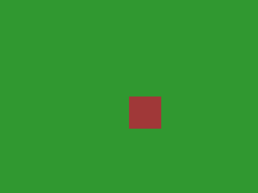
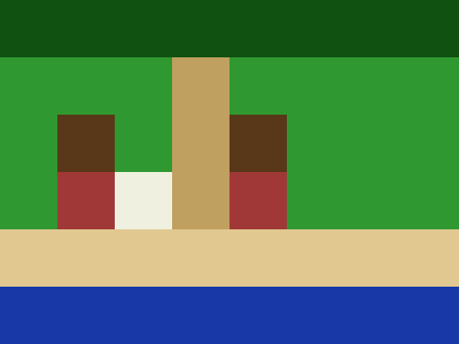

# 04 — The render-and-critique loop

> The reason porymap-mcp exists in its final form.

Without L3, an agent that edits maps is **blind**: it writes bytes, calls a few tools, and never sees the result. The L1 surface is enough to be productive, but it's typing-in-the-dark. L3 closes the loop:

```
paint  →  render  →  critique  →  fix  →  re-render
```

Once a Claude session can *see* its own output, scoring it against a 12-criterion Gen 3 rubric becomes a one-message round-trip, and a town that starts as a stranded house on a green canvas can converge on something with a coastline, a path, and a signpost in two iterations.

This example walks the loop end-to-end with a tiny synthetic project and a single map. It is the **worked example** of phase-4 §5 (CLAUDE.md §3).

---

## Two iterations, side by side

The script in this directory bootstraps an 8 × 6 map called `MAP_COASTALCOVE`, runs **iteration 1** (a deliberately weak first draft) and **iteration 2** (the same map after applying the critic's top fixes), and saves a render of each to `renders/`.

| Iteration | Render | What's there |
|-----------|--------|--------------|
| **iter 1** — naive draft |  | A single house tile dropped at (4, 3) on an otherwise empty grass canvas. No coast, no path, no variety. |
| **iter 2** — after critique |  | Tree-line frames the north edge. A path runs north-south through the middle of town. Two houses (roof + wall metatiles) flank the path. A signpost sits beside it. A sand strip transitions into a sea band along the south edge. |

The score jumps from **7 / 36** to **21 / 36** between iterations — see the [scoring section](#how-the-critic-scores) below.

---

## Running it yourself

The script uses only the **public Python API** of `porymap_mcp.tools`. Every paint and render call is one a real MCP client (Claude Desktop, Claude Code, etc.) would make over stdio. Run it from the repo root with the `render` extra installed:

```bash
pip install -e ".[dev]"        # or pip install ".[render]" once published
python examples/04_render_loop/run_demo.py
```

Output:

```
Bootstrapping synthetic project under _demo_project/

--- Iteration 1: draft ---
  Drop a single house tile at (4, 3). Otherwise leave the map blank.
  rendered iter 1: renders/iter1.png (1130 bytes)
map-design-critic — iter 1 (illustrative)
  Score: 7 / 36
  ...

--- Iteration 2: applying critic's top 5 fixes ---
  Coastline: water along the south edge, sand strip above it.
  ...
  rendered iter 2: renders/iter2.png (1625 bytes)
map-design-critic — iter 2 (illustrative)
  Score: 21 / 36   (delta: +14)
```

The synthetic project is created under `_demo_project/` (gitignored). It is destroyed and rebuilt on every run, so feel free to edit `run_demo.py` and iterate — the next invocation starts from a fresh canvas.

---

## What a real Claude session does

The script is faithful tool-for-tool to what a real session looks like over MCP, except that **iteration's critique** is hardcoded in Python. In a real session the critic is its own sub-agent, invoked via the `Task` tool. Roughly:

### Step 1 — Brief

The user gives a one-line brief:

> *"Make a small coastal town. 8 × 6. Trees up north, beach to the south, a path through the middle, two houses, a signpost."*

### Step 2 — Iter 1 draft

The agent paints whatever it can quickly stand up:

```
create_map(
    project_path="…/pokeemerald",
    name="CoastalCove",
    group="gMapGroup_NewMaps",
    width=8, height=6,
    primary_tileset="gTileset_PrimaryDemo",
    secondary_tileset="gTileset_SecondaryDemo",
    fill_metatile_id=GRASS,
)
paint_metatile(project_path, "MAP_COASTALCOVE", 4, 3, HOUSE_WALL)
```

### Step 3 — Render

```
render_map(project_path, "MAP_COASTALCOVE", scale=4)
```

Returns a `ToolResult` whose `content[0]` is an `ImageContent` PNG block. The agent now *sees* iter 1. (See `src/porymap_mcp/tools/rendering.py` for the full signature; ADR-0010 §"MCP return shape" for the contract.)

### Step 4 — Critique

```
Task(
    subagent_type="map-design-critic",
    description="Score iter 1 of CoastalCove",
    prompt=(
        "Brief: small coastal town, 8x6, trees north, beach south, "
        "path through middle, two houses, signpost. Score the attached "
        "render and list the top 5 fixes ordered by impact-per-effort. "
        "Use the 12-criterion rubric from your system prompt."
    ),
    # In Claude Code the previous render_map result is in context, so the
    # critic sees the PNG without explicit attachment.
)
```

The `map-design-critic` sub-agent ships with this repo at `.claude/agents/map-design-critic.md` and reads images, scores them, and proposes the smallest set of fixes that would raise the score. Its output is the punchlist the agent applies next.

### Step 5 — Iter 2 fixes

A few `paint_rectangle` and `paint_metatile` calls — the exact ones in `run_demo.py::iter2_revision`:

```
paint_rectangle(project_path, "MAP_COASTALCOVE", 0, 5, 7, 5, WATER)
paint_rectangle(project_path, "MAP_COASTALCOVE", 0, 4, 7, 4, SAND)
paint_rectangle(project_path, "MAP_COASTALCOVE", 0, 0, 7, 0, TREE)
paint_rectangle(project_path, "MAP_COASTALCOVE", 3, 1, 3, 3, PATH)
paint_metatile(project_path, "MAP_COASTALCOVE", 4, 2, HOUSE_ROOF)
paint_metatile(project_path, "MAP_COASTALCOVE", 1, 2, HOUSE_ROOF)
paint_metatile(project_path, "MAP_COASTALCOVE", 1, 3, HOUSE_WALL)
paint_metatile(project_path, "MAP_COASTALCOVE", 2, 3, SIGN)
```

### Step 6 — Re-render & re-score

```
render_map(project_path, "MAP_COASTALCOVE", scale=4)
Task(subagent_type="map-design-critic", ...)  # iter 2 verdict
```

The agent stops once the score crosses **30 / 36** or the user signals satisfaction. Typical convergence: 2-4 iterations.

### Shortcut — `return_render`

Every L1 mutation tool also accepts `return_render: bool = False`. Set it `True` on the *last* paint in an iteration to fold the render call into the same response — one network round-trip instead of two. The critic still runs as its own `Task`.

---

## How the critic scores

The full rubric lives in [`.claude/agents/map-design-critic.md`](../../.claude/agents/map-design-critic.md). The illustrative scores in this example reflect the same axes:

| # | Axis | iter 1 | iter 2 |
|---|------|--------|--------|
| 1 | Coastal feature present | 0 / 3 | 3 / 3 |
| 2 | Tile variety (distinct metatiles used) | 1 / 3 | 3 / 3 |
| 3 | Path geometry | 0 / 3 | 2 / 3 |
| 4 | Building count + recognizability | 1 / 3 | 2 / 3 |
| 5 | Edge framing (trees / cliffs / sea) | 0 / 3 | 2 / 3 |
| 6 | Walkable density | 2 / 3 | 3 / 3 |
| 7 | Event coherence (warps land on path) | 1 / 3 | 1 / 3 |
| 8 | Building placement (faces path / not stranded) | 0 / 3 | 2 / 3 |
| 9 | Elevation realism | 1 / 3 | 1 / 3 |
| 10 | Connection alignment | 0 / 3 | 0 / 3 |
| 11 | Border softness | 0 / 3 | 1 / 3 |
| 12 | Brief adherence | 1 / 3 | 1 / 3 |
| | **Total** | **7 / 36** | **21 / 36** |

(In a real session the numbers come from the critic agent's own scoring of the rendered PNG. The numbers above are hand-derived from the same axes to keep this README self-contained.)

The iter 2 score still leaves headroom — buildings are 1 tile wide, the path doesn't transition cleanly into the sand, and the signpost sits in the path rather than on its shoulder. Those are the iter 3 punchlist.

---

## Why solid-colour metatiles?

The synthetic tileset in this example uses solid-coloured metatiles, one colour per palette slot, so the rendered output is easy to read at a glance without bundling real Gen 3 art into the repo. In a real workflow you point `project_path` at a checkout of `pret/pokeemerald` (or `rh-hideout/pokeemerald-expansion`), and the same paint + render calls produce real-looking maps — `tools/rendering.py` doesn't care whether each metatile is a solid colour or a fully drawn Pokémon Center.

The loop, the tool surface, and the critic's role are all identical between the synthetic demo and a real project. Only the underlying art changes.

---

## See also

- The critic agent: [`.claude/agents/map-design-critic.md`](../../.claude/agents/map-design-critic.md)
- The renderer agent: [`.claude/agents/map-renderer.md`](../../.claude/agents/map-renderer.md)
- The phase-4 spec: [`docs/phases/phase-4-l3-vision.md`](../../docs/phases/phase-4-l3-vision.md)
- The renderer design: [`docs/decisions/0010-l3-renderer-design.md`](../../docs/decisions/0010-l3-renderer-design.md)
- The synthetic-project pattern: [`tests/unit/tools/test_rendering.py`](../../tests/unit/tools/test_rendering.py)
